<div align="center">

<a href="https://tessera.kition.ai">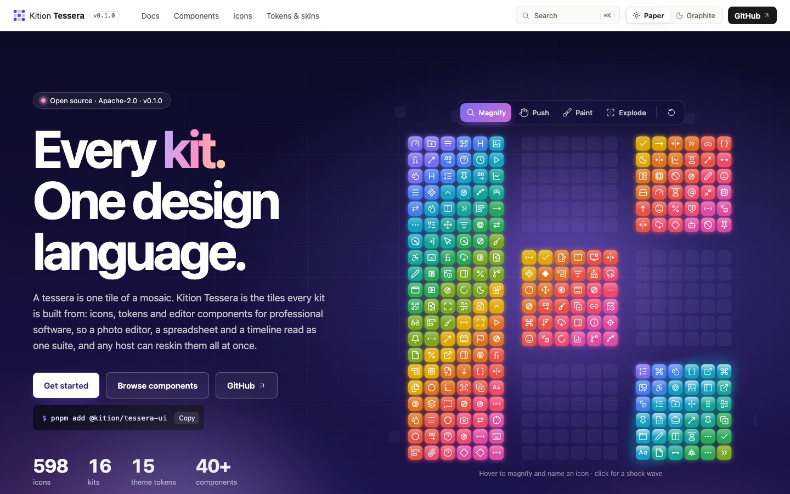</a>

# Kition Tessera

**The design system for AI-native professional software.**

Ribbons, docks, color wheels, curves and timelines beside buttons and fields.<br />
One icon family for React, canvas and Rust. One theme that reskins every editor at once.

### 🌐 [tessera.kition.ai](https://tessera.kition.ai)

[Components](https://tessera.kition.ai/components/) · [Icons](https://tessera.kition.ai/icons/) · [Tokens and skins](https://tessera.kition.ai/tokens/) · [Docs](https://tessera.kition.ai/docs/overview/) · [Markdown docs](docs/README.md) · [Kition](https://kition.ai)

[](https://github.com/KitionAI/kition-tessera/actions/workflows/ci.yml)
[](LICENSE)
[](https://tessera.kition.ai/components/)
[](https://tessera.kition.ai/icons/)
[](https://tessera.kition.ai/llms.txt)

</div>

A tessera is one tile of a mosaic. Tessera is the tiles professional editors are built from:
design tokens, an icon set, and the components general-purpose design systems do not have.
Kition's sixteen kits, from Photo and Film to Sheet and CAD, are built from it, so they read as
one suite and any host can reskin them all at once.

<p align="center">
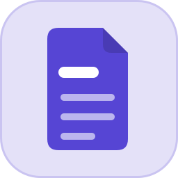
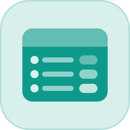
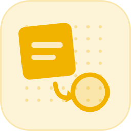
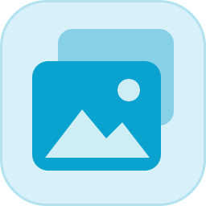

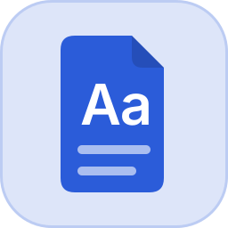
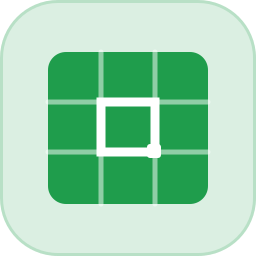
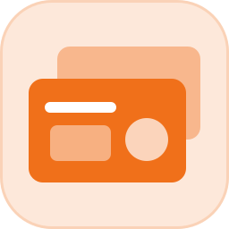
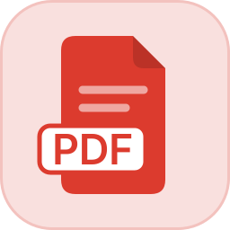
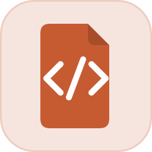
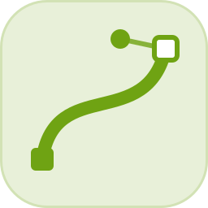
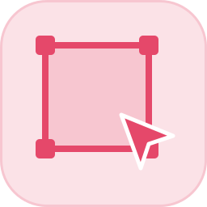
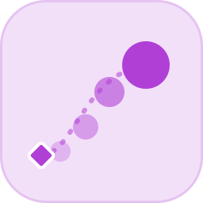
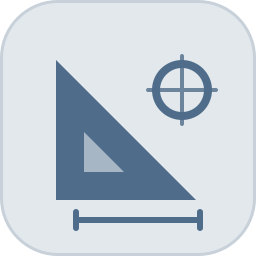
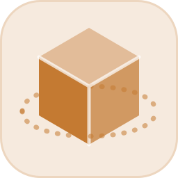
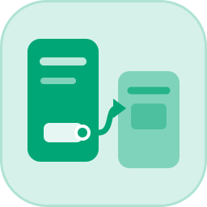
</p>

## See it

<table>
<tr>
<td width="50%">
<a href="https://tessera.kition.ai/components/">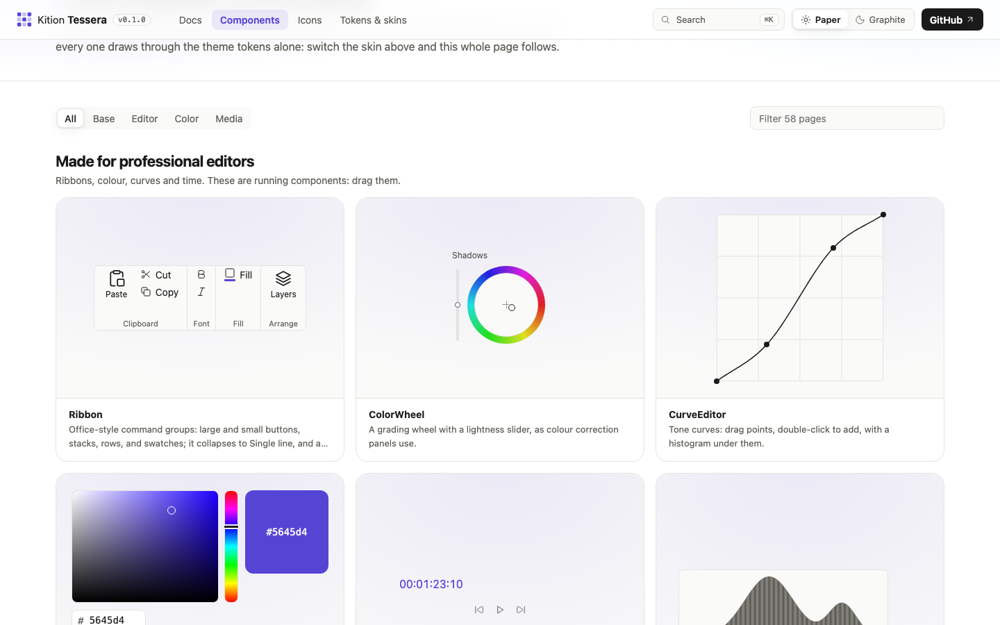</a>
<p><b>Components made for editors.</b> Ribbon, dock and floating panels, color picker and wheel, curves, histogram, timecode, transport, keyframes, level meter, beside the base controls. <a href="https://tessera.kition.ai/components/">Browse all 109</a>.</p>
</td>
<td width="50%">
<a href="https://tessera.kition.ai/docs/button/">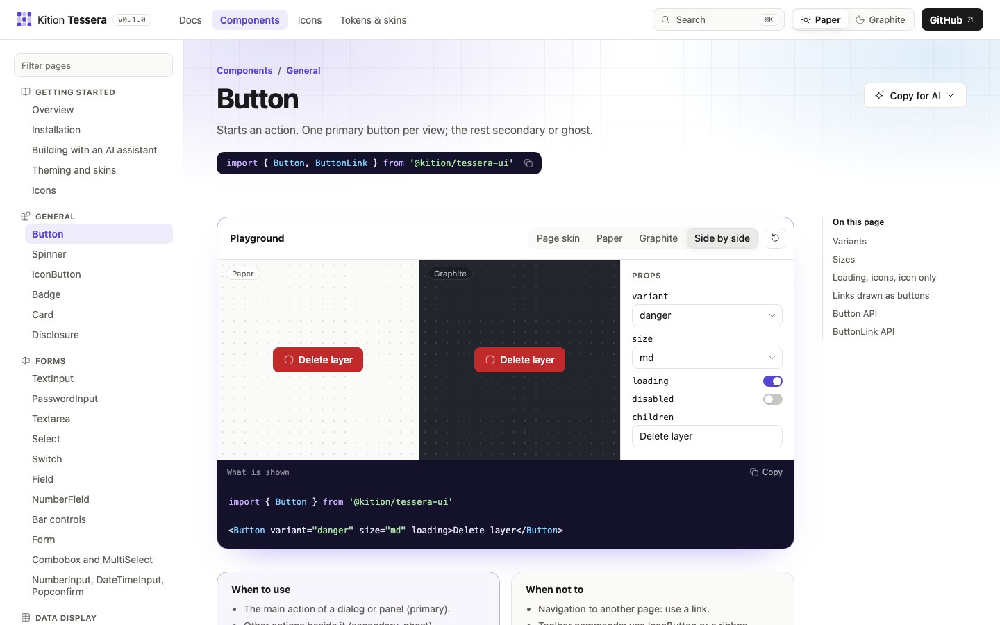</a>
<p><b>A playground on every common component.</b> Change the props, see both skins side by side, and copy the code of exactly what is shown.</p>
</td>
</tr>
<tr>
<td width="50%">
<a href="https://tessera.kition.ai/icons/">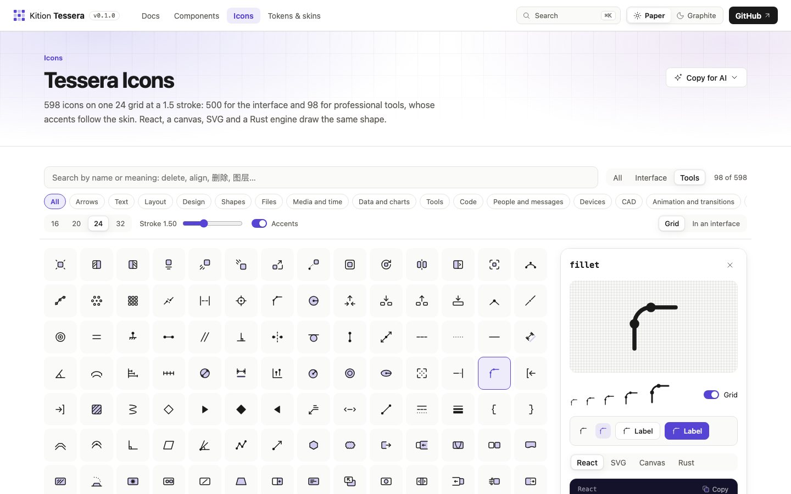</a>
<p><b>598 icons, found by meaning.</b> Search <code>delete</code>, <code>bevel</code> or <code>round corner</code>; take an icon as React, SVG, canvas or Rust. Tool icons carry accents that follow the skin.</p>
</td>
<td width="50%">
<a href="https://tessera.kition.ai/tokens/">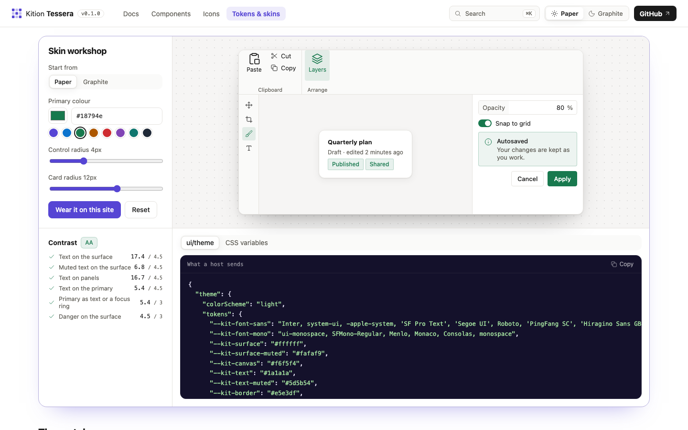</a>
<p><b>Skins from 15 tokens.</b> Pick a primary color and radii, watch an editor take them, check contrast against WCAG AA, and export the theme a host sends.</p>
</td>
</tr>
</table>

## Why Tessera

- **Built for editors.** General design systems stop at forms and tables. Tessera goes on:
  ribbons, docks, color wheels, curves, timecode, transport, and meters.
- **Styled only by tokens.** No component hard-codes a color, radius, or shadow. A skin is one
  value per theme token; send a theme and everything follows.
- **One icon family, everywhere.** Every icon is SVG path data on a 24 grid, so React, a canvas
  `Path2D`, and a Rust engine draw the same shape.
- **An open theme contract.** The theme tokens are the Kit Harness Protocol's (`--kit-*`, sent
  in `ui/initialize` and `ui/theme`). Any kit that follows the contract can be reskinned by any
  host; Tessera is the quickest way to follow it.
- **Written for people and for language models.** Every guide and component page is also a
  Markdown file in [`docs/`](docs/README.md), with `llms.txt` and `llms-full.txt` on the site,
  and a [guide to building with an AI assistant](https://tessera.kition.ai/docs/ai/).

## Packages

| Package | What |
| --- | --- |
| [`@kition/tessera-tokens`](packages/tokens) | Design tokens as CSS variables and TypeScript; the Paper and Graphite skins as themes |
| [`@kition/tessera-icons`](packages/icons) | Tessera Icons: path data, React components, canvas drawing, SVG markup; kit app icons |
| [`@kition/tessera-ui`](packages/ui) | Components: base controls, forms, data display, ribbon, dock and floating panels, color, curves, timeline controls |
| [`tessera-tokens`](crates/tessera-tokens) (Rust) | The same tokens for engines that draw on the canvas |
| [`tessera-icons`](crates/tessera-icons) (Rust) | The same icons for engines |

All five share one version, now 0.1.0.

## Quick start

```bash
pnpm add @kition/tessera-ui @kition/tessera-icons @kition/tessera-tokens
```

Components need React 19 and React DOM 19 or later. The npm distributions contain compiled
ES modules and TypeScript declarations; use them in a React app with a bundler such as Vite.
Import the stylesheet once at the app root. It includes the default Paper theme.

```tsx
import '@kition/tessera-ui/styles.css'
import { Button, IconButton } from '@kition/tessera-ui'
import { LayersIcon } from '@kition/tessera-icons/react'

export function Toolbar() {
  return (
    <>
      <IconButton icon={LayersIcon} label="Layers" />
      <Button variant="primary">Save</Button>
    </>
  )
}
```

Apply a skin by setting its theme tokens (a kit's host does this over the Kit UI protocol):

```ts
import { SKINS } from '@kition/tessera-tokens'

const theme = SKINS.graphite
for (const [name, value] of Object.entries(theme.tokens)) document.documentElement.style.setProperty(name, value)
document.documentElement.dataset.colorScheme = theme.colorScheme
```

Draw the same icon on a canvas, or as SVG markup:

```ts
import { Layers, drawIcon, toSvg } from '@kition/tessera-icons'

drawIcon(ctx, Layers, 8, 8, { size: 16, color: '#5645d4' }) // also in workers
toSvg(Layers, { size: 16 })
```

## Documentation

- **[tessera.kition.ai](https://tessera.kition.ai)**: guides, one page per component with live
  examples and props, icon search, tokens and skins.
- **[`docs/`](docs/README.md)**: the same docs as Markdown, for coding assistants and other tools
  that read text. Also at [`/llms.txt`](https://tessera.kition.ai/llms.txt) and
  [`/llms-full.txt`](https://tessera.kition.ai/llms-full.txt).

See [CONTRIBUTING.md](CONTRIBUTING.md) to build and contribute, and [CHANGELOG.md](CHANGELOG.md)
for what changed.

## License

Apache-2.0; see [LICENSE](LICENSE) and [NOTICE](NOTICE). Icons drawn from Lucide keep Lucide's
ISC and MIT notices; see [`packages/icons/NOTICE`](packages/icons/NOTICE). The Kition and Tessera
names and the kit app icons are trademarks of Kition AI.
